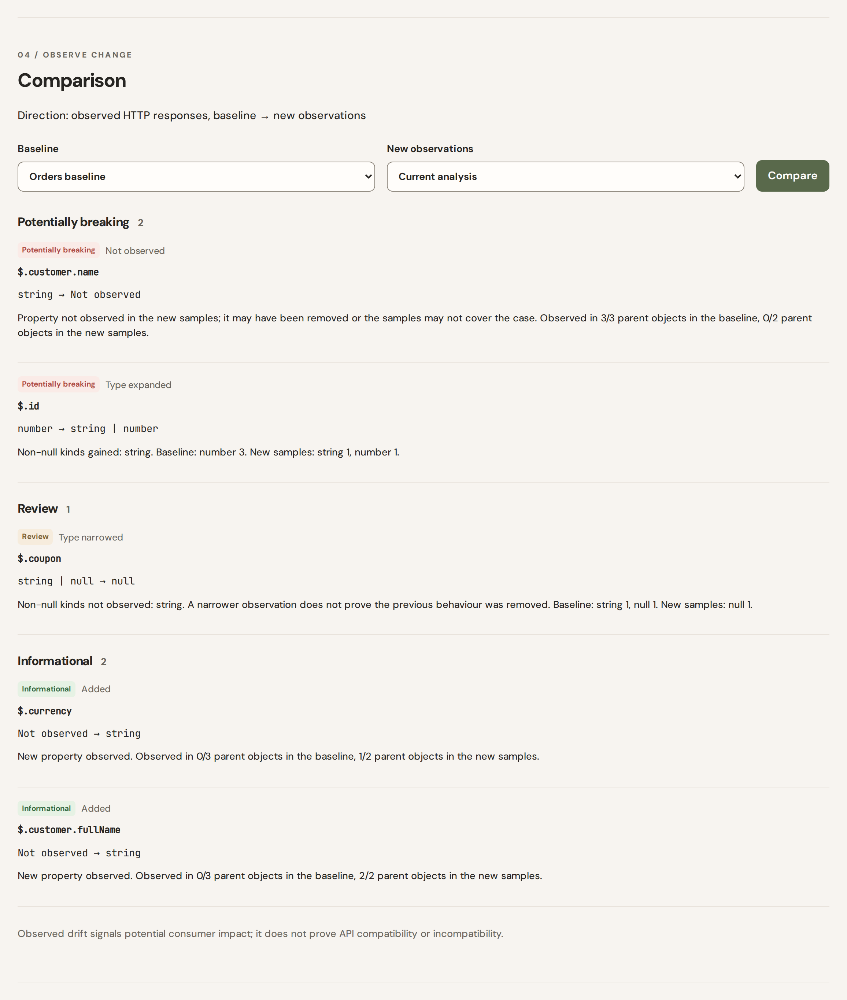

# API Archaeologist

A browser-only tool that infers TypeScript, Zod and JSON Schema contracts from multiple JSON responses, keeps the observed evidence, and compares contracts for drift. It runs locally in the browser without an API connection or backend.





## How it works

1. Paste JSON responses, upload JSON files, or select `Load example` to analyze the three fictional order fixtures. One document is one response sample, including a root array.
2. Inspect the inferred fields and their evidence. In the example, `coupon` is present in 2/3 parent objects and has one null observation, making it optional and nullable for separate reasons.
3. Copy or download TypeScript, Zod 4 or JSON Schema 2020-12 generated from the same contract tree.
4. Save the baseline as a local snapshot, then select `Load new observations`. Compare the saved baseline with `Current analysis` to see five changes, including an expanded `id` type and an unobserved `customer.name`.

## Design decisions

The core is pure TypeScript. A Web Worker runs parsing, inference, generation and comparison; React presents its output. Vite builds a static application, so neither an application server nor a remote database is needed. Dexie stores snapshots in IndexedDB only when explicitly saved.

Tools such as quicktype already address type generation from JSON. This project's focus is preserving evidence across multiple samples and explaining observed drift. Presence is counted per parent object, nullability is separate from absence, and comparison labels describe potential consumer impact. The [architecture document](docs/architecture.md) walks through the real fixtures and engine outputs.

## Privacy and security

- Samples are processed locally, without analytics, remote inference or API requests. Fonts and assets are bundled.
- Snapshots contain aggregated contracts and metadata, not raw response bodies. Property names can still disclose API information.
- Input is parsed as JSON and rendered as text. Generated code is exported, never executed by the application.
- Production headers restrict resources to the app origin. Remove tokens, personal data and secrets before sharing screenshots or exports.

## Limitations

Samples do not prove the full API contract. A field observed in every parent may still be optional in unseen responses, and no observed drift does not guarantee compatibility. The engine does not infer enums, formats or discriminated unions. Generated schemas allow additional properties. Browser storage may be cleared or evicted.

Inputs are bounded to 200 samples, 5 MiB per sample, 20 MiB per session, depth 50 and 2,000,000 visited values. The [limitations document](docs/limitations.md) records validator edge cases, the measured artificial workloads and the CSP style exception. No public deployment has been made.

## Local use

`VITE_REPOSITORY_URL` is an optional build-time variable for the repository URL, for example `VITE_REPOSITORY_URL=https://github.com/<owner>/<repo> pnpm build`. The GitHub and Documentation links are hidden when it is unset. The Docker images do not pass it, so those links are hidden there.

Use Node 24.21.0 from `.nvmrc`. pnpm 12.23.0 is declared in `packageManager`; make it available through Corepack (`corepack enable`) or a manual installation of that version.

```sh
pnpm install --frozen-lockfile
pnpm dev
```

Open `http://localhost:5173`. For a local production build and preview:

```sh
pnpm build
pnpm --filter @api-archaeologist/web preview
```

The preview listens on `http://127.0.0.1:4173`. It does not apply Cloudflare's `_headers`; use the production container to check the serving headers and CSP.

For development in Docker, run `docker compose up --build` and open `http://127.0.0.1:5173`. The container runs as `node`, mounts source for hot reload and keeps its three dependency directories and pnpm store in named volumes. Stop it with `docker compose down`. Restarting preserves those volumes and does not affect browser snapshots.

Docker dev creates the `node_modules` mount points, so use either the local pnpm workflow or Docker dev in a checkout, or delete those root-owned `node_modules` directories before switching back to local.

For production preview:

```sh
docker compose -f compose.prod.yaml up --build -d
# Open http://127.0.0.1:8080
docker compose -f compose.prod.yaml down
```

If dependency volumes need renewal, stop the dev service, identify the exact volumes for this Compose project with `docker volume ls` and `docker volume inspect`, and remove only its `root_node_modules`, `web_node_modules`, `core_node_modules` and `pnpm_store` volumes. Recreate the dev service afterward. Do not prune unrelated volumes. Snapshots belong to the browser origin and profile, not these volumes; different ports have separate storage.

Run checks and install the E2E browser when setting up a development machine:

```sh
pnpm lint
pnpm typecheck
pnpm format:check
pnpm test
pnpm build
pnpm --filter @api-archaeologist/core bench
pnpm --filter @api-archaeologist/web exec playwright install --with-deps chromium
pnpm test:e2e
```

E2E builds and launches Vite preview automatically. The Chromium project runs desktop specs; the Pixel 7 project runs only the mobile spec. To run the same suite against an already running production container:

```sh
E2E_BASE_URL=http://127.0.0.1:8080 pnpm test:e2e
```

With `E2E_BASE_URL` set, Playwright does not launch a server. Each test rejects requests outside the app origin and uses fictional data. Failure reports are written to `apps/web/playwright-report`.

## Cloudflare Pages

The static build is prepared for Cloudflare Pages; see the [deployment instructions](docs/deploy-cloudflare-pages.md). Deployment has not been done and no public URL exists yet.

## License

[MIT](LICENSE).

## Implementation references

- [Evidence model](packages/core/src/types.ts) and [inference](packages/core/src/inference.ts)
- [Normalization and evidence counts](packages/core/src/normalization.ts)
- [Contract comparison](packages/core/src/comparison.ts)
- [Generators](packages/core/src/generators)
- [Worker adapter](apps/web/src/workers/analysis.worker.ts)
- [Snapshot storage](apps/web/src/features/snapshots/db.ts)
- [E2E specs](apps/web/e2e) and [Playwright configuration](apps/web/playwright.config.ts)
- [Docker stages](Dockerfile) and [Nginx configuration](nginx.conf)
- [Production headers](apps/web/public/_headers)
- [CI workflow](.github/workflows/ci.yml)
