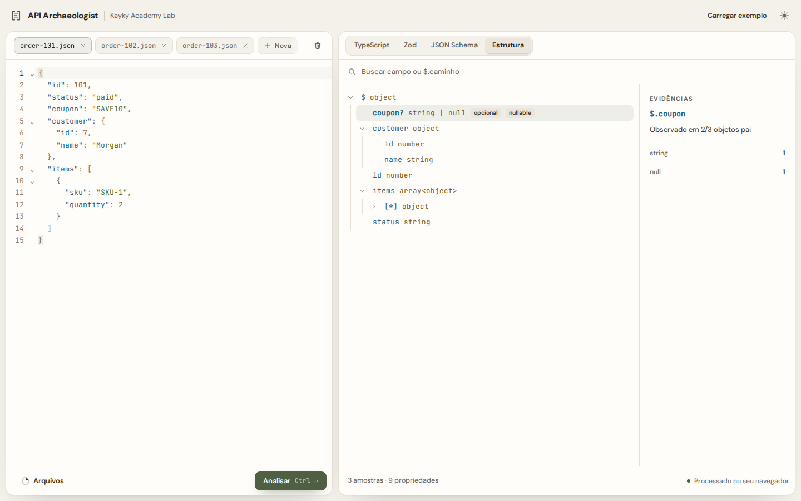

# API Archaeologist

A browser-only tool that infers TypeScript, Zod and JSON Schema contracts from multiple JSON responses and keeps the observed evidence behind each field. It runs locally in the browser without an API connection or backend.





The interface is in Brazilian Portuguese (pt-BR).

## How it works

1. Paste a JSON response into the editor, choose `Arquivos`, or drop `.json` files onto the input pane. `Carregar exemplo` loads three fictional order responses. One document is one sample, including a root array.
2. Select `Analisar` (Ctrl/Cmd+Enter). Draft text becomes a sample and every non-empty sample is analyzed together. `Adicionar` (Ctrl/Cmd+Shift+Enter) stores the draft without analyzing, so several responses can be combined. Each sample appears as a chip above the editor; select it to view or edit it, remove it with its close button, or remove all samples at once. `Nova` returns to an empty draft.
3. The result pane opens on `TypeScript`, with `Zod`, `JSON Schema` and `Estrutura` beside it. The code tabs have copy and download buttons. Downloads are named `contrato.ts`, `contrato.zod.ts` and `contrato.schema.json`.
4. `Estrutura` shows the inferred tree and the evidence for the selected field. In the example, `coupon` is shown as `Observado em 2/3 objetos pai` and has one null observation, making it optional and nullable for separate reasons. Search by property name or by a path starting with `$`, such as `$.items[*].sku`. Matching ancestors remain visible. Expanded nodes render 200 children per batch, including search results, with a control to show more.
5. Dark is the default theme. The toggle in the header switches to light with a View Transition that spreads the new theme from the button; browsers without View Transitions, or with reduced motion enabled, switch instantly.

## Design decisions

The core is pure TypeScript. A Web Worker runs parsing, inference and generation; React presents its output. Vite builds a static application, so neither an application server nor a database is needed.

Tools such as quicktype already address type generation from JSON. This project's focus is preserving evidence across multiple samples. Presence is counted per parent object, and nullability is separate from absence.

The interface is two panes that fill the viewport: input on the left and the generated contract on the right, which is the larger of the two. Transient feedback such as copy confirmations appears as a short toast instead of permanent text.

## Privacy and security

- Samples and contracts are processed only in the browser, kept in memory for the session and never sent anywhere. There is no remote inference or API fetching. Fonts and application assets are bundled.
- The only value stored in the browser is the theme choice, in `localStorage`.
- The public deployment at https://academy-api-archaeologist.kaykygarcia.dev uses Cloudflare Web Analytics. Its beacon records the page URL path, referrer, browser and device data derived from the user agent, and performance timings; Cloudflare derives approximate location from the IP address. It sets no cookies and does not read page content or samples. The app has no routes or query strings, so its URL carries no user data. Self-hosted builds (Docker or your own static hosting) include no analytics.
- Input is parsed as JSON and rendered as text. Generated code is exported, never executed by the application.
- Production headers restrict resources to the app origin, with a Cloudflare Pages exception for the Web Analytics script and beacon. Remove tokens, personal data and secrets before sharing screenshots or exports.

## Limitations

Samples do not prove the full API contract. A field observed in every parent may still be optional in unseen responses. The engine does not infer enums, formats or discriminated unions. Generated schemas allow additional properties. Samples are lost when the page is reloaded.

Inputs are bounded to 200 samples, 5 MiB per sample, 20 MiB per session, depth 50 and 2,000,000 visited values. The contract tree renders 200 children per batch; in one local measurement a sample with 50,000 properties at one level was painted about 0.9 s after Analyze, compared with 7.9 s before incremental rendering. The CSP allows inline styles because the code editor injects them.

## Local use

`VITE_REPOSITORY_URL` is an optional build-time variable for the repository URL, for example `VITE_REPOSITORY_URL=https://github.com/<owner>/<repo> pnpm build`. The GitHub link is hidden when it is unset. The Docker images do not pass it, so those links are hidden there.

Use Node 24.21.0 from `.nvmrc`. pnpm 12.23.0 is declared in `packageManager`; make it available through Corepack (`corepack enable`) or a manual installation of that version.

```sh
pnpm install --frozen-lockfile
pnpm dev
```

Open `http://localhost:5173`. For a local production build and preview:

```sh
pnpm build
pnpm --filter @api-archaeologist/web preview
```

The preview listens on `http://127.0.0.1:4173`. It does not apply Cloudflare's `_headers`; use the production container to check the Docker headers and CSP, and the live Pages deployment to check its analytics exception.

For development in Docker, run `docker compose up --build` and open `http://127.0.0.1:5173`. The container runs as `node`, mounts source for hot reload and keeps its three dependency directories and pnpm store in named volumes. Stop it with `docker compose down`. Restarting preserves those volumes.

Docker dev creates the `node_modules` mount points, so use either the local pnpm workflow or Docker dev in a checkout, or delete those root-owned `node_modules` directories before switching back to local.

For production preview:

```sh
docker compose -f compose.prod.yaml up --build -d
# Open http://127.0.0.1:8080
docker compose -f compose.prod.yaml down
```

If dependency volumes need renewal, stop the dev service, identify the exact volumes for this Compose project with `docker volume ls` and `docker volume inspect`, and remove only its `root_node_modules`, `web_node_modules`, `core_node_modules` and `pnpm_store` volumes. Recreate the dev service afterward. Do not prune unrelated volumes.

Run checks and install the E2E browser when setting up a development machine:

```sh
pnpm lint
pnpm typecheck
pnpm format:check
pnpm test
pnpm build
pnpm --filter @api-archaeologist/core bench
pnpm --filter @api-archaeologist/web exec playwright install --with-deps chromium
pnpm test:e2e
```

E2E builds and launches Vite preview automatically. The Chromium project runs desktop specs; the Pixel 7 project runs only the mobile spec. To run the same suite against an already running production container:

```sh
E2E_BASE_URL=http://127.0.0.1:8080 pnpm test:e2e
```

With `E2E_BASE_URL` set, Playwright does not launch a server. Each test rejects requests outside the app origin except for the exact Cloudflare Web Analytics hostnames `static.cloudflareinsights.com` and `cloudflareinsights.com`, and uses fictional data. Console errors and page errors still fail. Failure reports are written to `apps/web/playwright-report`.

## Cloudflare Pages

The application is deployed at https://academy-api-archaeologist.kaykygarcia.dev on Cloudflare Pages, with build command `pnpm build` and output directory `apps/web/dist`. Pages reads Node from `.nvmrc` but ignores `packageManager`, so the project sets the environment variable `PNPM_VERSION=12.23.0`. Security headers come from `apps/web/public/_headers`. To check the live site, run `E2E_BASE_URL=https://academy-api-archaeologist.kaykygarcia.dev pnpm test:e2e`.

## License

[MIT](LICENSE).

## Implementation references

- [Evidence model](packages/core/src/types.ts) and [inference](packages/core/src/inference.ts)
- [Normalization and evidence counts](packages/core/src/normalization.ts)
- [Tree search](packages/core/src/search.ts)
- [Generators](packages/core/src/generators)
- [Worker adapter](apps/web/src/workers/analysis.worker.ts)
- [App state](apps/web/src/App.tsx), [sample pane and drop zone](apps/web/src/features/samples/SamplesPanel.tsx) and [sample state](apps/web/src/features/samples/useSamples.ts)
- [Result pane](apps/web/src/features/contract/ContractSection.tsx), [incremental tree](apps/web/src/features/contract/ContractTree.tsx) and [tabs](apps/web/src/components/Tabs.tsx)
- [Theme switch](apps/web/src/lib/theme.ts) and [toggle](apps/web/src/components/ThemeToggle.tsx)
- [Styles and theme tokens](apps/web/src/styles/index.css)
- [E2E specs](apps/web/e2e) and [Playwright configuration](apps/web/playwright.config.ts)
- [Docker stages](Dockerfile) and [Nginx configuration](nginx.conf)
- [Production headers](apps/web/public/_headers)
- [CI workflow](.github/workflows/ci.yml)
